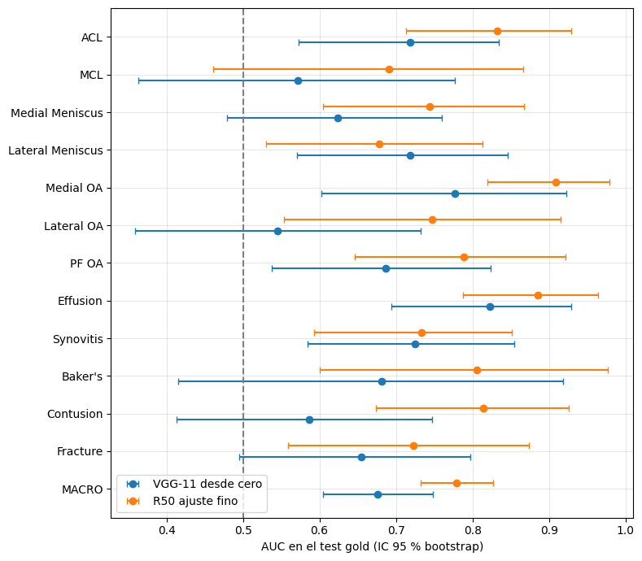

# Rodilla RSNA: 12 hallazgos en resonancia magnética con supervisión débil

Clasificación **multietiqueta** de 12 anomalías de rodilla en RM (Sagital FS) usando como etiquetas de
entrenamiento las que se extraen automáticamente de los **reportes radiológicos en 9 idiomas**.
Evaluación en **56 estudios con etiquetas gold** que nunca se usaron para entrenar ni para ajustar nada.

> Examen parcial (Pregunta 1) del curso **Redes Neuronales y Aprendizaje Profundo**, UNI FIIS, 2026-II.
> Datos: competencia Kaggle [`rsna-knee-abnormality-detection`](https://www.kaggle.com/competitions/rsna-knee-abnormality-detection).

## Resultados

| Modelo | Entrada | AUC macro val (débil) | **AUC macro test gold** [IC 95 %] |
|---|---|---|---|
| VGG-11 con BatchNorm, desde cero | 15 cortes (2.5D) | 0.727 | 0.676 [0.604 – 0.748] |
| ResNet-50 ImageNet, extractor fijo | 3 cortes como RGB | 0.660 | 0.690 [0.631 – 0.743] |
| **ResNet-50 ImageNet, ajuste fino** | 3 cortes como RGB | 0.752 | **0.779 [0.732 – 0.827]** |

- Extractor de etiquetas débiles: acuerdo macro con el gold **0.83** (κ 0.56), es decir, ≈ 17 % de ruido.
- ResNet-50 con ajuste fino − VGG-11: **+0.103 [+0.034, +0.182]** (bootstrap pareado, significativo).
- Ablación (política de las etiquetas inciertas, ResNet-18 frente a ResNet-50): sin diferencias significativas.



El análisis completo (desbalance, umbrales, Grad-CAM, sesgos por idioma y fabricante, limitaciones) está en
**[REPORTE.md](REPORTE.md)**. El recorrido de columnas y filas etapa por etapa está en
[`docs/flujo_datos.html`](docs/flujo_datos.html): descárgalo y ábrelo en el navegador.

## Pipeline

```
FASE 1 · TEXTO           (Colab)        01_etiquetas_debiles.ipynb + src/extractor.py
  train.csv ─► limpieza (NFKC, RTF, ∆→Δ) ─► idioma ─► extractor de reglas ─► 12 etiquetas 1 / 0 / −1
            ─► validación contra los gold ─► selección de 656 estudios ─► dataset_cnn.csv + series_cnn.csv

FASE 2 · IMÁGENES        (Kaggle CPU)   02_preprocesamiento_dicom.ipynb → 03_cortes_npy.ipynb
  750 series ─► contraste DP/T2 + desempate ─► 656 series ─► lateralidad R/L
            ─► orientar, 15 cortes en mm (−28…+28), normalizar, 256×256 ─► 656 × .npy [15, 256, 256]

FASE 3 · MODELOS         (Kaggle GPU)   04_entrenamiento.ipynb
  VGG-11 BN desde cero · ResNet-50 (extractor fijo / ajuste fino)
            ─► AUC + IC por bootstrap en 56 gold ─► umbrales, P/R/F1 ─► ablación ─► Grad-CAM ─► sesgos
```

## Estructura

```
rodilla-rsna-weak/
├── README.md
├── REPORTE.md                          ← informe completo con todos los resultados
├── requirements.txt
├── notebooks/
│   ├── 01_etiquetas_debiles.ipynb      ← Pasos 1–9: exploración, limpieza, extractor, validación, selección
│   ├── 02_preprocesamiento_dicom.ipynb ← Paso 10.1–10.2: elección de serie, contraste, lateralidad
│   ├── 03_cortes_npy.ipynb             ← Paso 10.3–10.5: DICOM → tensores .npy
│   └── 04_entrenamiento.ipynb          ← Pasos 11–15: modelos, evaluación, ablación, Grad-CAM, sesgos
├── src/
│   └── extractor.py                    ← reglas del extractor de etiquetas débiles (12 hallazgos, 9 idiomas)
├── figuras/                            ← figuras de los notebooks (p2_… a p14_…)
├── docs/
│   ├── flujo_datos.html                ← diagrama interactivo: qué columnas entran y salen en cada etapa
│   └── diagrama_flujo_texto.md         ← diagrama en texto de los Pasos 0–9
├── modelos/                            ← pesos .pt (se publican en Releases, no en git)
├── resultados/                         ← salidas intermedias de Kaggle (opcional)
└── data/                               ← datos de la competencia (no se suben)
```

**Los notebooks ya están ejecutados y guardan sus salidas** (tablas, figuras e interpretación de cada paso).
Para revisar los resultados no hace falta ejecutar nada: basta con abrirlos en GitHub o en Jupyter.

## Requisitos

### Entorno

| Fase | Dónde se ejecutó | Hardware | Notas |
|---|---|---|---|
| 01 (texto) | Google Colab | CPU | Monta Google Drive; también corre en local con Python ≥ 3.10 |
| 02, 03 (DICOM) | Kaggle Notebook | CPU | Los DICOM (~570 GB) solo existen dentro de Kaggle |
| 04 (modelos) | Kaggle Notebook | **GPU T4** | 3 modelos + ablación + Grad-CAM |

### Paquetes de Python

```bash
pip install -r requirements.txt
```

| Paquete | Para qué se usa |
|---|---|
| `numpy`, `pandas`, `pyarrow` | tablas y archivos `.parquet` |
| `matplotlib` | figuras |
| `scikit-learn` | AUC, kappa, métricas |
| `langdetect` | detección del idioma de los reportes (01) |
| `pydicom` | lectura de las cabeceras y los píxeles DICOM (02, 03) |
| `opencv-python` | redimensionado de los cortes (03) |
| `torch`, `torchvision` | VGG-11, ResNet-50 con pesos de ImageNet (04) |
| `tqdm` | barras de progreso |

En Kaggle todos vienen preinstalados. En Colab solo hace falta `pip install langdetect`.

### Datos

Los datos son de la competencia y **no se incluyen** en el repositorio (las reglas de Kaggle no permiten
redistribuirlos). Hay que aceptar las reglas de la competencia en Kaggle y luego:

```bash
pip install kaggle          # requiere ~/.kaggle/kaggle.json con tu token
kaggle competitions download -c rsna-knee-abnormality-detection -f train.csv        -p data/
kaggle competitions download -c rsna-knee-abnormality-detection -f train_series.csv -p data/
```

Solo se descargan los dos CSV; las imágenes se leen directamente dentro de Kaggle.

## Cómo reproducir

1. **Notebook 01 (Colab).** Subir `data/train.csv`, `data/train_series.csv` y `src/extractor.py` a una carpeta de
   Google Drive y cambiar la variable `path` de la primera celda de código por esa carpeta. Al ejecutarlo genera
   `data/cnn/dataset_cnn.csv` (656 estudios) y `data/cnn/series_cnn.csv` (750 series).
2. **Kaggle Dataset.** Subir esos dos CSV como un Dataset privado (en el original: `rodilla-cnn`).
3. **Notebook 02 (Kaggle, CPU).** Inputs: la competencia + el Dataset del paso 2. *Save & Run All* →
   `series_elegidas.csv`.
4. **Notebook 03 (Kaggle, CPU).** Inputs: la competencia + el Dataset + la salida del 02. *Save & Run All* →
   `npy/*.npy`, `indice_npy.csv`, `log_npy.csv`.
5. **Notebook 04 (Kaggle, GPU T4).** Input: la salida del 03. *Save & Run All* → métricas, figuras y pesos `.pt`.

Las rutas de Kaggle (`/kaggle/input/competitions/…`, `/kaggle/input/datasets/<usuario>/…`,
`/kaggle/input/notebooks/<usuario>/…`) están al inicio de cada notebook. Si tu usuario es otro, hay que cambiarlas.
La semilla es fija (`42`) en la selección de estudios y en el entrenamiento.

## Modelos entrenados

Los pesos (`state_dict` de PyTorch) se publican en la sección **Releases** del repositorio, porque superan el
tamaño recomendado por GitHub:

| Archivo | Modelo | Tamaño |
|---|---|---|
| `resnet50_ajuste_fino.pt` | **modelo final** | 94 MB |
| `resnet50_extractor_fijo.pt` | ResNet-50, solo la capa `fc` entrenada | 94 MB |
| `vgg11_base.pt` | VGG-11 con BatchNorm desde cero, 15 canales | 54 MB |

```python
import torch, torchvision
model = torchvision.models.resnet50()
model.fc = torch.nn.Linear(2048, 12)
model.load_state_dict(torch.load("modelos/resnet50_ajuste_fino.pt", map_location="cpu"))
model.eval()
# entrada: cortes [2, 7, 12] del .npy (−20, 0, +20 mm) como RGB, 256×256, normalizados con media/desv. de ImageNet
# salida: 12 logits → torch.sigmoid → probabilidad por hallazgo
```

Orden de las 12 salidas: `ACL, MCL, Medial Meniscus, Lateral Meniscus, Medial OA, Lateral OA, PF OA, Effusion,
Synovitis, Baker's, Contusion, Fracture`.

## Aviso

Proyecto académico. **No es una herramienta clínica**: no está validado clínicamente y se evaluó con solo 56 casos
de referencia. Las imágenes de resonancia que aparecen en las figuras y en las salidas de los notebooks provienen
de la competencia RSNA y se usan con fines educativos bajo sus reglas.
